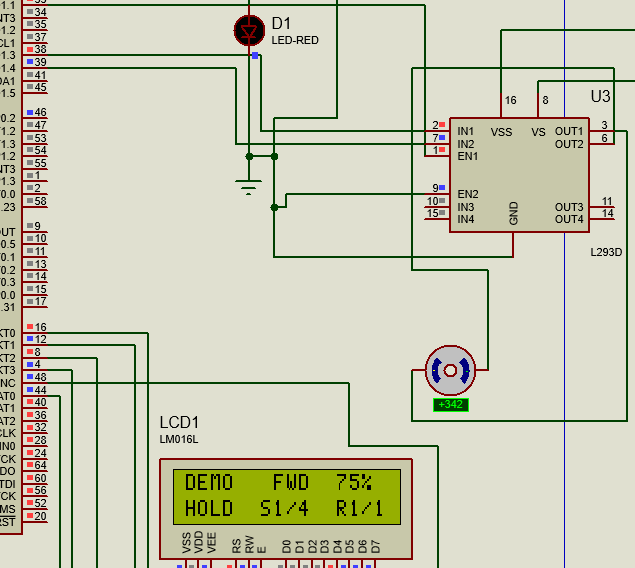
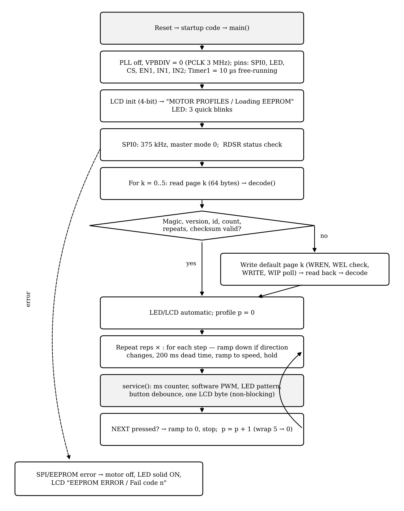
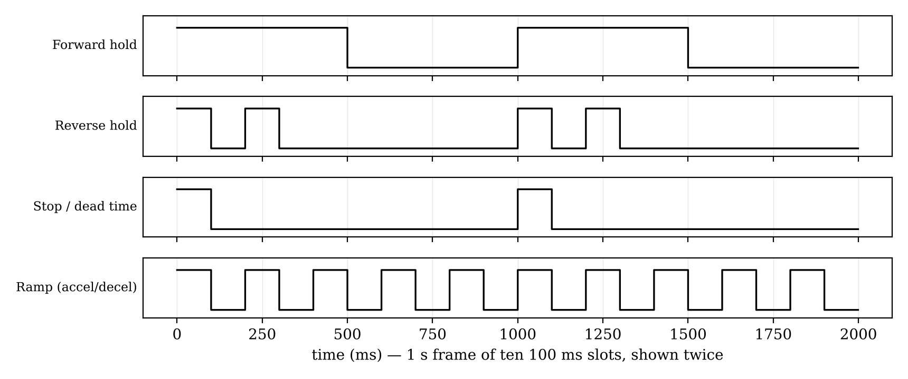
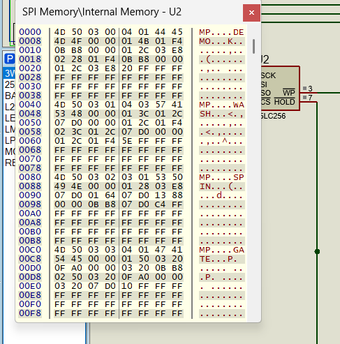

<p align="center">
  
</p>

<p align="center">
  
  
  
  
  
</p>

<p align="center">
  <a href="docs/Project_Report.pdf"><b>Project report</b></a> ·
  <a href="firmware/main.c"><b>Firmware</b></a> ·
  <a href="simulation/"><b>Proteus project</b></a> ·
  <a href="#getting-started"><b>Getting started</b></a>
</p>

---

## Overview

A bare-metal controller that runs **six everyday-appliance motor profiles** stored in a **25LC256 SPI EEPROM**. At power-up the LPC2138 reads and verifies every profile, restores any blank or corrupt one from built-in defaults, and runs them in sequence on a DC motor through an **L293D H-bridge**. A **16×2 LCD** shows what the motor is doing, and the **status LED** blinks a different pattern for forward, reverse, stop and ramping.

All timing runs on one free-running timer, while the LCD, LED and button are serviced in the background. As a result the motor timing is exact and never drifts. Everything is written at register level, with no vendor HAL, RTOS or C library. The same source builds in Keil µVision or with the GNU Arm toolchain, and runs on the LPC2138 and the LPC2148.

## Motor profiles

| # | Name | Real-life use | What the motor does | Repeats | Time |
|:-:|---|---|---|:-:|:-:|
| 1 | `DEMO` | Test profile | Forward 75 % 3 s → stop → reverse 40 % 3 s → stop | 1 | 9.6 s |
| 2 | `WASH` | Washing-machine wash | Agitation: forward 60 % 2 s ↔ reverse 60 % 2 s | 3 | 18.6 s |
| 3 | `SPIN` | Washing-machine spin-dry | Soft start 40 % → ramp to 100 % for 5 s → long coast-down | 1 | 15.0 s |
| 4 | `GATE` | Gate / garage door | Open (forward 80 % 4 s), wait 3 s, close (reverse 80 % 4 s) | 1 | 16.2 s |
| 5 | `FAN` | Natural-breeze fan | 30 % → 60 % → 90 % → 50 %, smooth changes | 2 | 24.0 s |
| 6 | `MIXER` | Blender pulse | 100 % bursts of 0.7 s with 0.5 s pauses | 3 | 4.8 s |

The full sequence takes **88.2 s** and then repeats. An optional **NEXT** button on P0.15 skips to the next profile.

## Proteus simulation

<p align="center">
  
</p>
<p align="center"><sub>LPC2138, 25LC256 SPI EEPROM, L293D driver, DC motor, 16×2 LCD and status LED</sub></p>

<table>
  <tr>
    <td align="center"><br><sub><b>DEMO</b>, forward 75 % — +342 RPM</sub></td>
    <td align="center"><br><sub><b>WASH</b>, repeat 3 of 3 — +278 RPM</sub></td>
    <td align="center"><br><sub><b>SPIN</b>, ramping to 100 % — +404 RPM</sub></td>
  </tr>
  <tr>
    <td align="center"><br><sub><b>GATE</b>, opening at 80 % — +371 RPM</sub></td>
    <td align="center"><br><sub><b>MIXER</b>, slowing after a pulse</sub></td>
    <td align="center"><br><sub>Measured drive over the full 88.2 s sequence (emulation)</sub></td>
  </tr>
</table>

## Highlights

| Area | Implementation |
|---|---|
| **SPI** | SPI0 master, mode 0, 375 kHz, GPIO chip select, time-out on every byte |
| **EEPROM** | One profile per 64-byte page; WREN with WEL check, WIP polling, page-safe writes |
| **Data integrity** | Magic, version, page id, range checks and checksum per page; automatic restore with read-back check |
| **Motor control** | 100 Hz PWM with 1 % steps, linear ramps of exact length, 200 ms dead time before every reversal; IN1 and IN2 never high together |
| **Timing** | Absolute scheduling on a free-running 10 µs timer: no drift, the sequence repeats exactly every 88.2 s |
| **LCD** | 4-bit HD44780 driver; each screen is sent one byte at a time in the background, so it never delays the motor |
| **Status** | Distinct LED patterns, LCD fault screen and `g_*` variables for the Proteus Watch Window |

## Architecture

<p align="center"></p>

<details>
<summary><b>Firmware flowchart</b></summary>
<p align="center"></p>
</details>

## Hardware

| Ref. | Component | Role |
|---|---|---|
| U1 | NXP LPC2138 (or LPC2148) | ARM7TDMI-S controller, 12 MHz, PCLK 3 MHz |
| U2 | Microchip 25LC256 | 32 KB SPI EEPROM storing six profiles |
| U3 | L293D | H-bridge driver (5 V logic, 12 V motor supply) |
| LCD1 | LM016L 16×2 LCD | Profile, direction, speed, phase, step and repeat |
| M1 | DC motor | Load |
| D1, R1 | LED, 330 Ω | Status indicator |
| S1 *(optional)* | Push-button + 10 kΩ pull-up | NEXT profile |

<details>
<summary><b>Pin map</b></summary>

| LPC2138 pin | Function | Connected to |
|---|---|---|
| P0.4 / SCK0 (27) | SPI clock | 25LC256 SCK (6) |
| P0.5 / MISO0 (29) | SPI data in | 25LC256 SO (2) |
| P0.6 / MOSI0 (30) | SPI data out | 25LC256 SI (5) |
| P0.7 (31) | Chip select (GPIO) | 25LC256 CS (1) |
| P0.8 (33) | PWM output | L293D EN1 (1) |
| P0.12 (38) / P0.13 (39) | Direction | L293D IN1 (2) / IN2 (7) |
| P0.1 (21) | Status LED | R1 → D1 → GND |
| P0.15 (45) | NEXT button (optional) | Button to GND, 10 kΩ to 3.3 V |
| P1.16 (16) / P1.17 (12) | LCD control | LCD RS (4) / E (6) |
| P1.18–P1.21 | LCD data | LCD D4–D7 (11–14) |

LCD RW, VSS and VEE go to GND, and LCD VDD goes to 3.3 V. EEPROM WP and HOLD are tied to 3.3 V. All LPC2138 supply pins, including VBAT, are at 3.3 V, and all grounds are common.
</details>

## LED and LCD status

| Motor state | LED | LCD example |
|---|---|---|
| Start-up | 3 quick blinks | `MOTOR PROFILES` / `Loading EEPROM` |
| Accelerating / decelerating | Fast blink, 5 Hz | `WASH   FWD  60%` / `ACCEL S1/4  R1/3` |
| Forward, holding speed | Slow blink, 0.5 s on / 0.5 s off | `DEMO   FWD  75%` / `HOLD  S1/4  R1/1` |
| Reverse, holding speed | Double flash every second | `GATE   REV  80%` / `HOLD  S3/4  R1/1` |
| Stopped / dead time | Single short flash every second | `DEMO   STOP  0%` / `OFF   S2/4  R1/1` |
| EEPROM or SPI fault | Solid on, motor off | `EEPROM ERROR` / `Fail code 3` |

<p align="center"></p>

A full table of LED and LCD states against time for the whole 88.2 s sequence is in the [project report](docs/Project_Report.pdf) (Table 9.2).

## EEPROM format

<p align="center"></p>

Profile *k* is stored at address *k* × 64. Each page has the following layout:

| Offset | Field | Rule |
|---|---|---|
| 0–1 | `'M' 'P'` | Magic |
| 2 | Version | 3 |
| 3 | Id | Equals the page number |
| 4 | Steps N | 1–8 |
| 5 | Repeats | 1–9 |
| 6–11 | Name | 6 ASCII characters, zero-padded |
| 12 + 6i | Step i | Direction, speed %, ramp ms (16-bit), run ms (16-bit) |
| 12 + 6N | Checksum | All bytes of the page sum to 0 (mod 256) |

<table>
  <tr>
    <td width="40%"></td>
    <td>

The memory window in Proteus after the first power-up matches the firmware's records **byte for byte**:

| Address | First bytes | Profile | Checksum |
|---|---|---|---|
| `0x000` | `4D 50 03 00 04 01 44 45 4D 4F` | DEMO, 4 steps, ×1 | `20` |
| `0x040` | `4D 50 03 01 04 03 57 41 53 48` | WASH, 4 steps, ×3 | `5E` |
| `0x080` | `4D 50 03 02 03 01 53 50 49 4E` | SPIN, 3 steps, ×1 | `C4` |
| `0x0C0` | `4D 50 03 03 04 01 47 41 54 45` | GATE, 4 steps, ×1 | `10` |

  </td>
  </tr>
</table>

To change a profile, edit `defaults[]` in `firmware/main.c` and increment `PROFILE_VERSION`. The firmware then rewrites the EEPROM on the next start-up.

## Getting started

### Keil µVision

1. Create a new project for **NXP LPC2138** (or LPC2148) and accept the default start-up file.
2. Add `firmware/main.c` to the project. Under **Options for Target**, tick **Create HEX File** and set **Optimization: Level 2**.
3. Build (F7). The firmware switches the PLL off itself, so the start-up file's clock settings don't matter.

### GNU Arm toolchain

```bash
# Windows
build.bat                          # firmware/main.c
build.bat tests\motor_test.c       # test program

# Linux / macOS
make
make SRC=tests/spi_eeprom_test.c
```

Output files: `build/firmware.elf` (with debug symbols) and `build/firmware.hex`.

### Simulate

1. Open `simulation/spi_motor_controller.pdsprj` in Proteus.
2. Set U1 **Program File** to the .hex or .elf file, and **Clock Frequency to 12 MHz**. The firmware assumes 12 MHz (`FOSC_HZ`); a 10 MHz setting makes every time 1.2× longer.
3. Set the motor's **Effective Mass** to about 0.0005, so its speed follows the LCD within about 0.3 s.
4. Run. Profiles start at 0.7 s (DEMO), 10.3 s (WASH), 28.9 s (SPIN), 43.9 s (GATE), 60.1 s (FAN) and 84.1 s (MIXER).

<details>
<summary><b>Fault codes and debug variables</b></summary>

| Indication | Meaning |
|---|---|
| `g_fail_code` | 1 SPI time-out · 2 SPI fault · 3 no EEPROM response · 4 write-protected · 5 WEL not set · 6 write time-out · 9 invalid profile |
| `g_profile_source` | 1 = all profiles found in EEPROM · 2 = at least one default written |
| `g_profile` · `g_step` · `g_rep` | Current profile, step and repeat |
| `g_direction` · `g_speed` · `g_phase` | 0 STOP / 1 FWD / 2 REV · duty % · 1 decel, 2 dead time, 3 accel, 4 hold |
| `g_led_pattern` · `g_cycles` · `g_time_ms` | Active LED pattern · completed sequences · ms since start |
</details>

## Verification

| Check | Result |
|---|---|
| Keil build | 0 errors, 6488 bytes of code |
| GNU build (`-Wall -Wextra -std=c90 -pedantic`) | 0 warnings at -O0 and -O2 |
| EEPROM contents in Proteus | Identical to the encoder output, checksums included |
| Full sequence (emulation) | 88.2 s, no drift; returns to DEMO at 88.9 s |
| PWM at 75 % / 40 % | 7.50 / 4.00 ms pulses (±25 µs), 10.00 ms period |
| Reversals | Always ≥ 200 ms off; IN1 and IN2 never high together |
| LCD | Never written while busy |
| NEXT button | Each press skips exactly one profile; contact bounce ignored |
| Faults (no EEPROM, SO stuck low, no SCK) | Codes 3, 5 and 1 on the LCD; motor held off |

> **Status:** verified in Proteus and in an instruction-level emulator; not yet tested on physical hardware.

## Engineering decisions

| Challenge | Decision |
|---|---|
| LCD updates paused the program for about 5 ms and delayed motor events | Non-blocking LCD: one byte per service call, 50 µs apart |
| Relative delays made ramps and stops drift by 5–20 % | All events on one absolute Timer1 schedule |
| Keil's start-up file enables the PLL (60 MHz), making every time 5× too short | `main()` switches the PLL off before starting the timers |
| The motor model's high inertia made its speed lag the LCD by seconds | Effective mass reduced in Proteus; the LCD shows the commanded speed |
| A corrupted record could break every profile | One profile per page, each checked and restored on its own |
| The 3 kHz hardware PWM made the analog motor simulation crawl | 100 Hz software PWM, about 30× fewer switching events |
| The ARM7TDMI has no hardware divide and no C library is linked | A small shift-and-subtract `udiv()` |

## Repository structure

```
├── firmware/
│   ├── main.c              multi-profile motor controller (LCD, LED, EEPROM)
│   ├── startup.s           vector table and C runtime start-up (GNU build)
│   └── linker.ld           memory map (flash 0x00000000, RAM 0x40000000)
├── tests/
│   ├── spi_eeprom_test.c   SPI/EEPROM write-read self-test
│   └── motor_test.c        L293D and motor wiring test
├── simulation/
│   └── spi_motor_controller.pdsprj
├── docs/
│   ├── Project_Report.pdf
│   └── images/
├── Makefile
└── build.bat
```

## Roadmap

- [x] Multiple stored profiles with per-page validation
- [x] LCD and LED status display
- [ ] Hardware build and bring-up
- [ ] Closed-loop speed control with encoder feedback
- [ ] Edit and select profiles over UART or with a keypad
- [ ] CRC-16 and A/B copies for power-fail-safe writes

## Author

**Ashish Kumar Kashyap**, B.Tech, Electronics and Communication Engineering, MNNIT Allahabad

Developed as a team project in the Department of ECE, Motilal Nehru National Institute of Technology Allahabad, under the guidance of **Dr. Shishir Maheshwari**.

## License

Released under the [MIT License](LICENSE).
