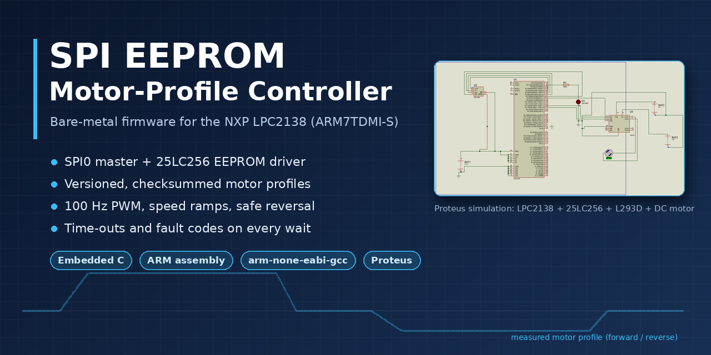
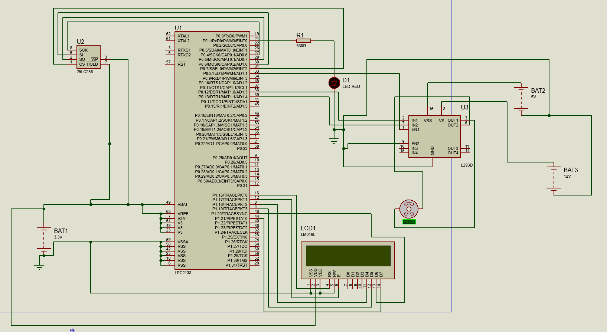
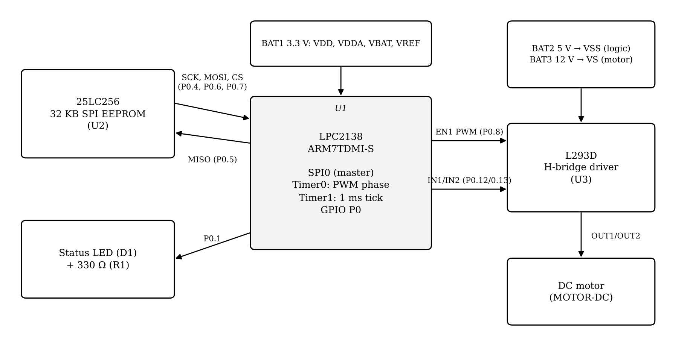
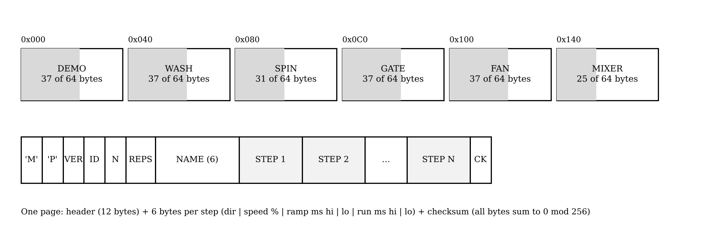
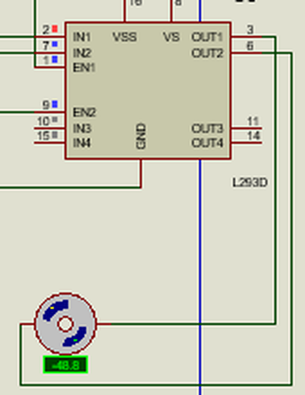
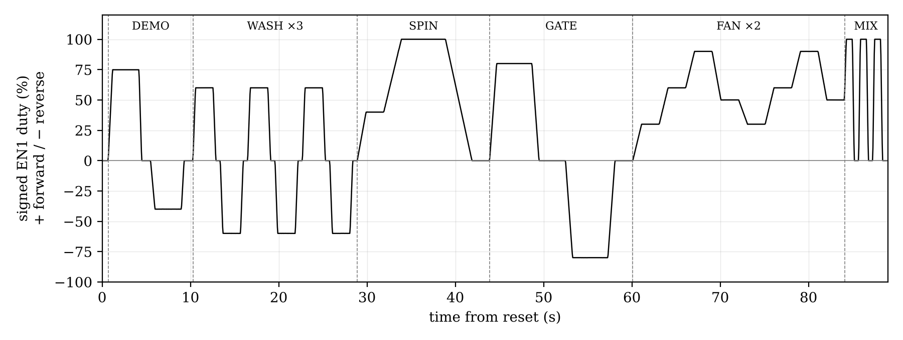

<p align="center">
  
</p>

<p align="center">
  
  
  
  
  
</p>

<p align="center">
  <a href="docs/Project_Report.pdf"><b>Project report</b></a> ·
  <a href="firmware/main.c"><b>Firmware</b></a> ·
  <a href="simulation/"><b>Proteus project</b></a> ·
  <a href="#getting-started"><b>Getting started</b></a>
</p>

---

## Overview

A bare-metal controller that keeps a DC motor's **speed and direction profile in non-volatile memory**. At power-up the LPC2138 reads the profile from a **25LC256 SPI EEPROM**, verifies it, and runs it on a DC motor through an **L293D H-bridge**. If the stored data is missing or corrupt, it writes a default profile and verifies that first.

Everything is written at register level: a custom start-up file and linker script, an SPI driver, an EEPROM driver, PWM and the motor control logic, with no vendor HAL, RTOS or C library.

## Proteus simulation

<p align="center">
  
</p>
<p align="center"><sub>Complete circuit in Proteus: LPC2138, 25LC256 SPI EEPROM, L293D driver, DC motor and status LED</sub></p>

## Highlights

| Area | Implementation |
|---|---|
| **SPI** | SPI0 master, mode 0,0, 375 kHz, GPIO chip select, time-out on every byte |
| **EEPROM** | WREN with WEL confirmation, page-aware writes (64 B), WIP polling, sequential reads |
| **Data integrity** | Magic bytes, version field, range checks and checksum; automatic default restore with read-back verification |
| **Motor control** | 100 Hz PWM with 1 % resolution, linear speed ramps, ramp-down and dead time before every reversal |
| **Robustness** | No unbounded waits; SPI, EEPROM and write faults stop the motor and report an error code |
| **Observability** | LED status patterns and `g_*` debug variables for the Proteus Watch Window |

## Architecture

<p align="center"></p>

**Boot sequence**

1. `startup.s` sets the stack, copies `.data`, clears `.bss` and calls `main()`.
2. GPIO, Timer1 (1 ms tick) and Timer0 (PWM phase) are initialised; the LED blinks three times.
3. The profile at EEPROM `0x0000` is read and validated, or the defaults are written and read back.
4. Profile steps run continuously. On any fault the motor is held off and the LED blinks at 5 Hz.

## Hardware

| Ref. | Component | Role |
|---|---|---|
| U1 | NXP LPC2138 | ARM7TDMI-S controller, 12 MHz, PCLK 3 MHz |
| U2 | Microchip 25LC256 | 32 KB SPI EEPROM storing the profile |
| U3 | L293D | H-bridge driver (5 V logic, 12 V motor supply) |
| M1 | DC motor | Load |
| D1, R1 | LED, 330 Ω | Status indicator |

<details>
<summary><b>Pin map</b></summary>

| LPC2138 pin | Function | Connected to |
|---|---|---|
| P0.4 / SCK0 (27) | SPI clock | 25LC256 SCK (6) |
| P0.5 / MISO0 (29) | SPI data in | 25LC256 SO (2) |
| P0.6 / MOSI0 (30) | SPI data out | 25LC256 SI (5) |
| P0.7 (31) | Chip select (GPIO) | 25LC256 CS (1) |
| P0.8 (33) | PWM output | L293D EN1 (1) |
| P0.12 (38) | Direction | L293D IN1 (2) |
| P0.13 (39) | Direction | L293D IN2 (7) |
| P0.1 (21) | Status LED | R1 → D1 → GND |

EEPROM WP and HOLD are tied to 3.3 V. All LPC2138 supply pins, including VBAT, are at 3.3 V, and all grounds are common.
</details>

## EEPROM profile format

<p align="center"></p>

| Step | Direction | Speed | Ramp | Run |
|:---:|:---:|:---:|:---:|:---:|
| 0 | Forward | 75 % | 500 ms | 3000 ms |
| 1 | Stop | 0 % | 300 ms | 1000 ms |
| 2 | Reverse | 40 % | 500 ms | 3000 ms |
| 3 | Stop | 0 % | 300 ms | 1000 ms |

The default profile is 29 bytes and is written in a single page write. To change it, edit `default_steps[]` in `firmware/main.c` and increment `PROFILE_VERSION`.

## Getting started

**Prerequisites:** [Arm GNU Toolchain](https://developer.arm.com/downloads/-/arm-gnu-toolchain-downloads) on `PATH`, and Proteus Design Suite for simulation.

```bash
# Windows
build.bat                          # firmware/main.c
build.bat tests\motor_test.c       # test program

# Linux / macOS
make
make SRC=tests/spi_eeprom_test.c
```

Output files: `build/firmware.elf` (with debug symbols) and `build/firmware.hex`.

**Simulate:**

1. Open `simulation/spi_motor_controller.pdsprj` in Proteus.
2. Set U1 **Program File** to `build/firmware.elf` and **Clock Frequency** to 12 MHz.
3. Run the simulation. Use **Debug → Watch Window** to inspect the `g_*` variables.

<details>
<summary><b>Status codes</b></summary>

| Indication | Meaning |
|---|---|
| 3 blinks, then steady LED | Profile loaded, motor running |
| LED blinking at 5 Hz | EEPROM fault, motor held off |
| `g_fail_code` | 1 SPI time-out · 2 SPI fault · 3 no EEPROM response · 4 write-protected · 5 WEL not set · 6 write time-out · 9 invalid profile |
| `g_profile_source` | 1 = profile found in EEPROM · 2 = defaults written |
| `g_step` · `g_direction` · `g_speed` · `g_cycles` | Current step, direction, duty %, completed cycles |
</details>

## Results

<table>
  <tr>
    <td align="center" width="38%"><br><sub>L293D driving the motor (IN1 high, forward step)</sub></td>
    <td align="center"><br><sub>Measured drive over one profile cycle (ARM emulator)</sub><br><br><br><sub>Proteus running in real time: 3 min 36 s simulated at 29 % CPU</sub></td>
  </tr>
</table>

- **EEPROM self-test passed in Proteus:** two patterns, 0x5A and 0xA5, written and read back correctly.
- **Motor profile ran in Proteus,** with the profile loaded from EEPROM and the motor turning.
- **Fault handling verified in emulation:** blank, corrupt, old-version and unresponsive EEPROM, and a stalled SPI clock.

> **Status:** verified in simulation; not yet tested on physical hardware.

## Engineering decisions

| Challenge | Decision |
|---|---|
| The 3 kHz hardware PWM made the analog motor simulation run far slower than real time | Timer-based 100 Hz software PWM, about 30× fewer switching events; a hardware-PWM build remains available (`USE_HW_PWM`) |
| A single test value could pass on stale EEPROM data | Two complementary patterns (0x5A, then 0xA5) |
| An unbounded SPI wait could hang the CPU with no indication | Time-out on every wait, with a distinct error code |
| The ARM7TDMI has no hardware divide and no C library is linked | A small shift-and-subtract `udiv()` |

## Repository structure

```
├── firmware/
│   ├── main.c              motor-profile controller
│   ├── startup.s           vector table and C runtime start-up
│   └── linker.ld           memory map (flash 0x00000000, RAM 0x40000000)
├── tests/
│   ├── spi_eeprom_test.c   SPI/EEPROM write-read self-test
│   └── motor_test.c        L293D and motor wiring test
├── simulation/
│   └── spi_motor_controller.pdsprj
├── docs/
│   ├── Project_Report.pdf
│   └── images/
├── Makefile
└── build.bat
```

## Roadmap

- [ ] Hardware build and bring-up
- [ ] Closed-loop speed control with encoder feedback
- [ ] UART command interface to edit and select multiple stored profiles
- [ ] Interrupt-driven PWM and PLL configuration

## Author

**Ashish Kumar Kashyap**, B.Tech, Electronics and Communication Engineering, MNNIT Allahabad

Developed as a team project in the Department of ECE, Motilal Nehru National Institute of Technology Allahabad, under the guidance of **Dr. Shishir Maheshwari**.

## License

Released under the [MIT License](LICENSE).
